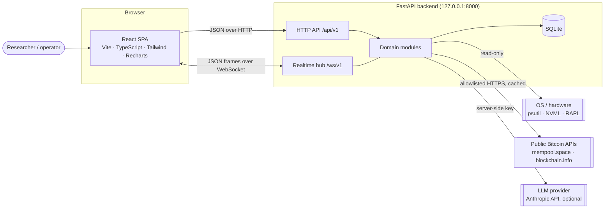

# NEXUS HASH AI — System Architecture

> Intelligence Beyond Computational Limits.

This document is the technical blueprint for NEXUS HASH AI. It describes what exists today
(Milestone 1) and the designs that later milestones implement. Decisions with lasting
consequences are recorded as ADRs in [`docs/adr/`](adr/).

---

## 1. Product principles

These are engineering constraints, not marketing copy. Each one is enforced in code and covered by tests.

| Principle | What it means in practice |
|---|---|
| **Truthful data** | Simulated, stale, estimated or unavailable data is always labelled as such. The UI never renders placeholder numbers as if they were real, and never shows a stale value as live (see `CommandPage` and its regression test). |
| **Explicit consent** | No CPU/GPU-intensive workload starts without an explicit, per-run user confirmation. No background mining, no hidden processes, no cloud compute, no spending. |
| **Secrets stay server-side** | API keys exist only in the backend's environment. The frontend learns only *whether* a key is configured. Secrets are `SecretStr` and are scrubbed from logs. |
| **Local-first and least exposure** | The API binds to loopback by default. Exposing it to a network requires an explicit opt-in. |
| **Graceful degradation** | Every external dependency (public APIs, hardware sensors, the LLM) can be missing. Its absence is reported as a capability state, never as a crash or a fake value. |
| **No cryptographic shortcuts** | HashLab demonstrates real SHA-256 proof-of-work. There is no claim, anywhere, of bypassing or accelerating Bitcoin's proof-of-work. |

---

## 2. System context



* **One origin for the browser.** In development, Vite proxies `/api` and `/ws` to the backend. In
  production (Milestone 10) FastAPI serves the built SPA itself, so CORS stays closed.
* **The backend is the trust boundary.** It validates every input, owns every secret, enforces every
  resource limit, and is the only component that talks to the outside world.

---

## 3. Repository layout

```
.
├── backend/                    Python 3.11+ · FastAPI · Pydantic v2 · uv
│   ├── nexus_hash/
│   │   ├── core/               Platform foundations (no domain logic)
│   │   │   ├── config.py       Typed settings, secret handling, bind policy
│   │   │   ├── errors.py       Error taxonomy + uniform JSON envelope
│   │   │   ├── middleware.py   Request ID, access log, security headers, body limits
│   │   │   ├── logging.py      Structured logs, request correlation, secret redaction
│   │   │   ├── realtime.py     Pub/sub hub, WebSocket protocol models
│   │   │   └── catalog.py      Module registry (status shown in the UI)
│   │   ├── api/                Thin routers: system.py, realtime.py, deps.py
│   │   ├── modules/            One package per product module (added per milestone)
│   │   ├── main.py             create_app() factory + lifespan
│   │   └── __main__.py         `nexus-hash` CLI entrypoint
│   └── tests/                  pytest suite (unit + HTTP/WebSocket integration)
├── frontend/                   React 19 · TypeScript 5.9 · Vite 8 · Tailwind 4
│   └── src/
│       ├── lib/                api client, realtime connection, query client, formatters
│       ├── hooks/              data hooks (TanStack Query)
│       ├── components/         layout shell + UI primitives (design system)
│       ├── pages/              route views
│       ├── config/             navigation / route table
│       ├── types/              API contract types (mirror backend models)
│       └── test/               fakes and fixtures
├── docs/                       architecture, roadmap, ADRs
├── scripts/dev.sh              runs backend + frontend together
├── Makefile                    developer entrypoints (`make help`)
└── .github/workflows/ci.yml    lint · typecheck · test · build · audit
```

---

## 4. Backend architecture

### 4.1 Layers

```
api/ (routers)        validate input, map to/from schemas, no business logic
   │
modules/<x>/service   domain logic, pure and unit-testable, no FastAPI imports
   │            ╲
providers         repositories        adapters to the outside world / SQLite
   │
core/                 config, errors, logging, middleware, realtime hub
```

Rules:

1. A module may import `nexus_hash.core`, but never another module's internals. Cross-module
   flows go through services, or through the realtime hub.
2. Routers stay thin: anything worth testing lives in a service.
3. Every external call goes through a provider class with a timeout and a typed result. That makes
   each provider replaceable with a fake in tests.

### 4.2 Request pipeline

Middleware is pure ASGI (no `BaseHTTPMiddleware`), so it adds no buffering and passes WebSocket
traffic straight through. Order from outermost to innermost:

| Layer | Responsibility |
|---|---|
| `SecurityHeadersMiddleware` | `nosniff`, `X-Frame-Options: DENY`, strict CSP for JSON, `no-store`, COOP/CORP, `Permissions-Policy` |
| `CORSMiddleware` | Explicit origin allowlist, no credentials, no wildcard |
| `RequestContextMiddleware` | Accepts or generates `X-Request-ID`, adds `Server-Timing`, writes a correlated access log, turns any unhandled exception into a generic 500 envelope |
| `BodySizeLimitMiddleware` | Rejects bodies over the limit with 413, including chunked uploads with no `Content-Length` |
| Exception handlers | `AppError` subclasses, HTTP errors and validation errors all map to the envelope |

### 4.3 Error envelope

Every non-2xx response has the same shape:

```json
{ "error": { "code": "permission_required", "message": "…", "request_id": "…", "details": [] } }
```

Codes come from a fixed enum (`ErrorCode`). Validation details are sanitised to `loc` / `msg` /
`type`, so user input is never echoed back. Internal exception text is logged and never returned.

Domain errors raise typed exceptions: `NotFoundError`, `ConflictError`, `PermissionRequiredError`,
`ResourceLimitError` and `UpstreamUnavailableError`.

### 4.4 Configuration

`Settings` (pydantic-settings) reads `NEXUS_*` environment variables and optional `.env` files.
Values are validated at startup and the settings object is immutable afterwards.

* An invalid config stops the server with a readable message (exit code 2, no traceback).
* A non-loopback bind requires `NEXUS_ALLOW_REMOTE_ACCESS=true`.
* A wildcard CORS origin is rejected.
* A test asserts that `.env.example` is valid, equals the code defaults, and documents every setting.

### 4.5 Realtime protocol (`/ws/v1`)

The browser opens one multiplexed connection and subscribes to topics:

| Direction | Message |
|---|---|
| client → server | `{"action":"subscribe","topics":["system","network"]}` · `{"action":"unsubscribe",…}` · `{"action":"ping"}` |
| server → client | `welcome` · `ack` · `pong` · `error` · `event {topic, type, ts, data}` |

| Topic | Publisher | Milestone |
|---|---|---|
| `system` | heartbeat: uptime, version, connection count | **1 (live)** |
| `activity` | activity log entries | 3 |
| `hashlab` | simulation job progress and results | 4 |
| `hardware` | telemetry samples | 5 |
| `network` | network snapshots | 6 |
| `intelligence` | recommendations and anomalies | 8 |

Guarantees:

* **Bounded memory.** Each client has a bounded outbound queue that drops the oldest message when
  full (drops are counted).
* **Ordered writes.** A single writer task per socket means frames are never interleaved.
* **Immediate state.** On subscribe, a client gets the current state of each topic. Live-state
  topics have a *snapshot provider* that computes a fresh value, so a stale count is never replayed.
* **Origin checks.** Browsers don't apply CORS to WebSockets, so `Origin` is checked against the
  allowlist to prevent cross-site WebSocket hijacking.
* **Limits.** Connection cap (close code 1013), message size cap (close code 1009), and text frames
  only.

The frontend's `RealtimeConnection` is framework-agnostic: it reconnects with exponential backoff
and jitter (1 s → 30 s), and React binds to it through `useSyncExternalStore`.

---

## 5. Module designs

Status values come from `core/catalog.py`. Designs below are the plan; each milestone refines its
own section when it lands.

### 5.1 HashLab: proof-of-work simulator (M4)

* **Real primitives.** The 80-byte Bitcoin block header is version, previous hash, merkle root,
  time, bits and nonce, serialised little-endian. Hashing is double SHA-256 via `hashlib`, and the
  compact `bits` field expands to a 256-bit target. The serialiser is verified against the genesis
  block header, so the test vector proves the implementation is real.
* **Educational difficulty.** Difficulty is expressed as leading zero bits (for example 8 to 28),
  so a CPU can find blocks in seconds. The UI shows how each extra bit doubles the expected work,
  and contrasts this with live network difficulty (M6).
* **Safe execution.**
  - Jobs run in a separate worker process (`ProcessPoolExecutor`), outside the GIL and off the
    event loop.
  - Hard caps apply to difficulty bits, attempts, wall time and concurrent jobs (default 1).
  - Jobs are cancellable and stream progress on the `hashlab` topic.
  - Sustained "benchmark" runs return `permission_required` unless the request carries an explicit
    consent flag that the user confirmed in the UI.
* **Mining competition.** Simulated miners with configurable hash-power shares compete. Block
  discovery follows a Poisson process in *simulated time*, so it costs negligible CPU while showing
  real variance and luck.
* **Labelling.** Every result carries `simulated: true`, and the UI badges it "SIMULATED — not
  Bitcoin network mining". A pure-Python CPU hash rate (on the order of 10⁵–10⁶ H/s per core) is
  shown next to the network rate to make the gap concrete.

### 5.2 Hardware Intelligence (M5)

* **Read-only sources.** `psutil` provides CPU (total and per-core), RAM, swap and load. NVIDIA GPUs
  use NVML (`nvidia-ml-py`) when present. Temperatures come from `psutil.sensors_temperatures()`
  where the OS exposes them. Power comes from NVML or Intel RAPL (`/sys/class/powercap`) when
  readable.
* **Capability matrix.** Each metric is reported as `{value, unit, supported, source, reason}`. For
  example, the dev container has no GPU, so it reports `supported: false,
  reason: "no NVIDIA driver"`, and the UI shows "Not available on this machine" rather than `0`.
* **Sampling.** A sampler runs at 1–2 s into an in-memory ring buffer. It publishes on the
  `hardware` topic and writes down-sampled history to SQLite with a retention policy.
* **Safety.** Monitoring never generates load and never needs elevated privileges.

### 5.3 Bitcoin Network Intelligence (M6)

* **Providers in priority order:**
  1. mempool.space: height, difficulty, adjustment, hash rate, mempool, fees, price
  2. blockchain.info: fallback
  3. CoinGecko: last-resort price only (it returned HTTP 429 from this environment)
* **Resilience.** Per-endpoint TTL caching (about 15–60 s), request timeouts and a circuit breaker.
  On failure the last good value is served with `stale: true`. Every value carries `as_of` and
  `source`, and the UI shows freshness.
* **Derived values are labelled as derived.** Block subsidy comes from height (halving every 210,000
  blocks; 3.125 BTC since block 840,000). Implied hash rate is `difficulty × 2³² / 600`.
* **Egress.** Outbound HTTP is restricted to an allowlist of these hosts.

### 5.4 Profitability Intelligence (M7)

* **Inputs** (validated ranges): hash rate, power draw, electricity price, hardware cost, pool fee,
  uptime, and optionally horizon, difficulty growth and BTC price scenarios.
* **Core model:** expected BTC per day = (your hash rate / network hash rate) × 144 × (subsidy +
  average fees) × (1 − pool fee). Costs are energy (kW × 24 × price) plus amortised hardware.
* **Uncertainty is first-class:**
  - low / base / high scenarios for difficulty growth and price
  - Poisson variance for solo mining vs pool smoothing
  - a sensitivity table and a break-even horizon, which may be "never"
* **Output** is always labelled *estimate*. It carries the full assumption set and the network data
  timestamp, and never says "guaranteed".

### 5.5 Nexus Intelligence: analytics engine (M8)

Deterministic, explainable analytics come first, and the LLM only narrates them:

* efficiency metrics (J/TH, hashes per watt, thermal headroom)
* inefficiency rules with evidence and severity
* anomaly detection on telemetry (EWMA and z-score)
* strategy comparison that reuses the profitability engine

Every recommendation cites the data it was derived from.

### 5.6 NEXUS CORE: AI agent (M8)

* **Backend-only LLM access** behind a provider interface. Anthropic's API is the first provider,
  with the model configurable via env. The key never leaves the server.
* **Grounding.** The backend assembles context from module services (hardware snapshot, network
  snapshot, simulation results, analytics findings) and passes it to the model as clearly delimited
  *data*. External content is never treated as instructions.
* **Advisory only.** The agent explains, analyses, reports and suggests. It cannot start workloads,
  change configuration, spend money or call arbitrary URLs. Any suggested action needs a separate
  user confirmation in the UI.
* **Offline mode.** Without an API key, NEXUS CORE answers from deterministic analytics plus a
  curated knowledge base (SHA-256, difficulty, halving, J/TH and so on), and says it is in offline
  mode.
* **Budgets.** Per-request token caps, rate limiting and streamed responses.

### 5.7 Nexus Command: dashboard (M2)

The dashboard composes the module topics into one command view: status tiles, Recharts time series
(hardware, simulation hash rate, network), recommendations and the activity log. Each panel owns its
loading, empty, stale and error states.

---

## 6. Data model (M3, SQLite)

SQLAlchemy 2.0 with Alembic migrations. WAL mode is on. Timestamps are UTC ISO-8601.

| Table | Purpose |
|---|---|
| `activity_log` | User-visible audit trail: who/what, action, outcome, timestamp |
| `telemetry_samples` | Down-sampled hardware metrics (retention-bounded) |
| `network_snapshots` | Network values plus source, `as_of` and stale flag |
| `simulation_runs` | HashLab job parameters, limits, consent flag, results, duration |
| `profitability_scenarios` | Saved calculator inputs plus assumption set |
| `agent_conversations` / `agent_messages` | NEXUS CORE history (opt-in retention) |
| `reports` | Generated reports (markdown) with provenance |

---

## 7. Security model (summary)

The full policy is in [`SECURITY.md`](../SECURITY.md). Controls implemented in M1, all tested:

* loopback bind by default
* validated, immutable configuration
* `SecretStr` secrets and log redaction
* strict security headers, CORS allowlist and WebSocket origin checks
* body and WebSocket size limits and a connection cap
* sanitised error responses with request IDs
* no secrets in the frontend bundle (only `VITE_*` variables are bundled, and none are secret)

---

## 8. Quality strategy

| Layer | Tooling | What is covered |
|---|---|---|
| Backend static | ruff (incl. bandit rules), mypy `--strict` | Style, bugs, security lint, types |
| Backend tests | pytest + TestClient, coverage | Config policy, error envelope, middleware, WebSocket protocol, hub, logging, CLI |
| Frontend static | ESLint (type-aware), tsc strict, Prettier | Types, hooks rules, formatting |
| Frontend tests | Vitest + Testing Library + fakes | API client, reconnect logic, full-app rendering incl. offline / degraded / stale states |
| E2E smoke | Playwright (run manually in M1; committed to the repo in M9) | Real browser against real servers, incl. kill/restart recovery |
| CI | GitHub Actions | All of the above on every PR, plus `npm audit` of runtime deps |

---

## 9. Deployment model

* **Development:** `make dev` runs uvicorn with reload on :8000 and Vite on :5173 (proxied).
* **Production (M10):** a single process where FastAPI serves the built SPA plus the API. An
  optional Docker image runs as non-root, read-only, with a SQLite volume. There is no paid
  infrastructure, and any hosting decision will be put to the project owner for approval.

---

## 10. Technology choices

| Concern | Choice | Why |
|---|---|---|
| API | FastAPI 0.16x on Starlette 1.x | Async, typed, OpenAPI for free |
| Validation | Pydantic v2 | Fast, strict, shared request/response contracts |
| Python tooling | uv + lockfile, ruff, mypy | Reproducible, fast |
| Persistence | SQLite (WAL) | Zero-ops, local-first, enough for single-user telemetry |
| Frontend | React 19, TypeScript 5.9, Vite 8 | TS pinned to 5.9 because typescript-eslint does not support TS 7 yet |
| Styling | Tailwind CSS 4 with `@theme` design tokens | Tokens in CSS, no runtime cost |
| Data fetching | TanStack Query 5 | Caching, polling, retry policy |
| Charts | Recharts 3 | Required by spec; composable |
| Fonts | Self-hosted via @fontsource | No third-party CDN requests (privacy, offline use) |
| Realtime | Native WebSocket | Bidirectional, one connection per tab |
